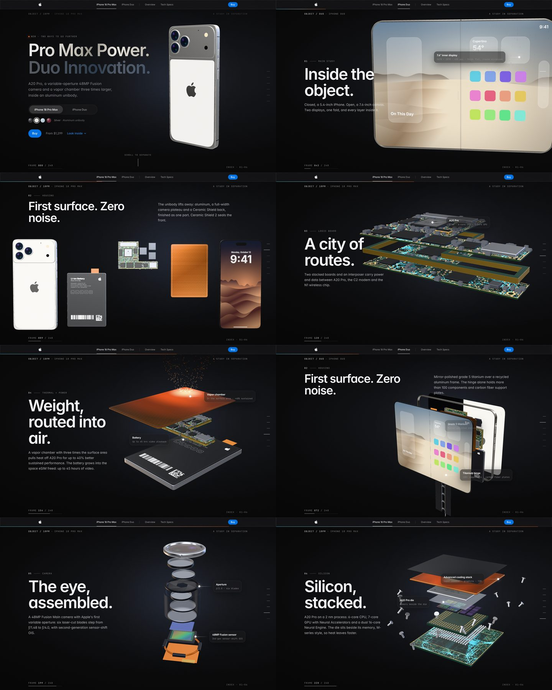

# iPhone Experience: Inside the object

A scroll-driven product page for **iPhone 18 Pro Max** and **iPhone Duo**, built in the style of Apple's own landing pages: dark, quiet, typographic, and centred on one long pinned sequence where the phone comes apart layer by layer as you scroll.



## What's on the page

| Section | What it does |
| --- | --- |
| **Glass nav** | Translucent bar with the Apple glyph, `iPhone 18 Pro Max` / `iPhone Duo` model switches, `Overview`, `Tech Specs` and `Buy`. A thin progress line tracks the pinned sequence. Collapses to a menu on phones. |
| **Hero** | "Pro Max Power. Duo Innovation." over the live 3D product. A segmented toggle swaps models and the finish swatches recolour the model in real time. |
| **Pinned sequence** (900vh) | A sticky WebGL viewport with five stages, plus a silicon close-up:<br>01 *Inside the object.*: the assembled phone (the Duo unfolds here)<br>02 *First surface. Zero noise.*: the unibody lifts away, then every layer lines up side by side<br>03 *A city of routes.*: the stacked logic board opens at the interposer and its traces pulse<br>04 *Weight, routed into air.*: battery and vapor chamber separate and heat rises off the chamber<br>05 *The eye, assembled.*: the 48MP Fusion lens explodes along its optical axis while the six-blade iris steps ƒ/1.48 → ƒ/4.0<br>06 *Silicon, stacked.*: the A20 Pro cooling stack separates with its screws in orbit |
| **Floating callouts** | Labels pinned to 3D anchor points (A20 Pro, lens, vapor chamber, hinge…). Positions are projected from the scene every frame, and the aperture label reads the live f-number. |
| **HUD** | The "study in separation" instrument layer: object ID, a frame counter (`FRAME 112 / 240`) and a chapter rail you can click to jump. |
| **Bento grid** | An interactive A20 Pro die map, a draggable aperture with a bokeh preview, battery bars, a housing finish picker (it drives the 3D model too), Duo photography and stat tiles. |
| **Tech specs** | A side-by-side comparison with a sticky model header and a "Highlight differences" switch. |
| **Buy** | Model cards with finishes and pricing. |

## Stack

- **Next.js 16** (App Router, Turbopack, fully static prerender) with **React 19** and **TypeScript**
- **Tailwind CSS 4** for styling, with design tokens in `src/app/globals.css`
- **GSAP 3 + ScrollTrigger** (`@gsap/react`) for scroll mapping, the chapter typography timeline and reveals
- **Lenis** for inertia scrolling, driven by GSAP's ticker
- **three.js** for the 3D scene; every part is modelled and textured procedurally
- Inter / JetBrains Mono via Fontsource as fallbacks when SF Pro / SF Mono aren't on the system

## Getting started

```bash
npm install
npm run dev     # http://localhost:3000
npm run lint
npm run build && npm start
```

Requires Node 20.9 or newer.

## Project structure

```
public/images/            Product photography (cut out for the dark UI)
docs/preview.jpg          README preview
src/
  app/                    layout, page, global styles, icon
  assets/                 Apple glyph path, font stacks, inline SVG icons
  components/
    nav/                  GlobalNav
    stage/                ProductStage (sticky viewport + ScrollTrigger), Hero,
                          ChapterOverlays, Callouts, Hud, StageFallback
    bento/                FeatureGrid and its interactive cards
    specs/                SpecsTable
    buy/                  BuySection
    footer/               Footer (footnotes, sources, disclaimer)
    providers/            ExperienceProvider (model + finish state), SmoothScroll
    ui/                   ModelToggle, FinishPicker, Reveal
  data/products.ts        Copy, finishes, chapter text, callouts, spec table, sources
  hooks/                  useMediaQuery / useReducedMotion
  lib/
    gsap.ts, smooth.ts, stageBus.ts
    three/
      Experience.ts       Renderer, lights, camera rig, model crossfade, anchor projection
      chapters.ts         Progress windows (CH) + shared camera moves
      timeline.ts         Keyframe tracks and the `Part` class (pose + per-part fades)
      models/             proMax.ts, duo.ts (geometry + choreography per device)
      parts/              logic board, battery, vapor chamber, displays, lens studio,
                          chip studio, heat particles
      textures.ts         Canvas-painted PCB traces, die shot, wallpapers, labels…
      materials.ts        Physical materials and shader patches (trace pulses, heat map)
```

## How the sequence works

1. `ProductStage` renders a 900vh section with a sticky, full-viewport canvas. A single `ScrollTrigger` maps the section's scroll range to `progress ∈ [0, 1]`.
2. `Experience` smooths that number and, every frame:
   - samples each part's keyframe **track** (`timeline.ts`) for position, rotation, scale and opacity
   - drives the special mechanics: the Duo fold angle and hinge explode, the board split, the lens explode and iris, and the chip stack with its orbiting screws
   - samples the model's **camera keys**, given as orbit angles plus a world-space box to frame, and lens-shifts with `setViewOffset` so the product sits beside the copy without skewing perspective
   - projects named anchor objects to screen space for the callouts
3. Chapter typography is a paused GSAP timeline laid out on the same 0–1 axis and seeked with that smoothed progress, so the words and the parts move together.

Timing for both models lives in one table (`CH` in `src/lib/three/chapters.ts` and `CHAPTER_WINDOWS` in `ChapterOverlays.tsx`). To retime a chapter, change it there.

Dimensions follow the published specs: Pro Max is 163.4 × 78.0 × 8.75 mm. Duo is 164.6 × 117.8 × 5.2 mm open and 117.8 × 84.1 × 11.3 mm closed.

## Research and assets

- **Specifications** come from Apple's iPhone 18 Pro Max tech specs and iPhone 18 Pro page, with launch coverage of iPhone Duo from MacRumors and GSMArena. They are listed under `SOURCES` in `src/data/products.ts` and in the footer. Where sources disagreed (Pro Max video playback: 43 vs 45 hours), the page uses Apple's US support page.
- **Internal components.** No license-clean exploded renders or 3D models of these devices exist, so the logic board (about 1,600 instanced components, routed traces and vias), the A20 Pro die shot, vapor chamber lattice, lens elements, sensor, battery label and lock-screen wallpapers are generated in code. Nothing in the 3D scene is a downloaded asset.
- **Photography** in `public/images` came with the project brief. The light-background shots were cut out for the dark page. Replace them with licensed imagery before shipping anything public.

## Accessibility and performance

- Respects `prefers-reduced-motion`: no inertia scrolling, idle sway or reveal animations. The sequence still follows the scrollbar directly.
- The canvas is `aria-hidden`, with a screen-reader description of the sequence. All chapter copy is real DOM text, and controls are buttons with labels and pressed/checked states.
- The renderer pauses when the stage scrolls off screen. Pixel ratio is capped at 2, and all textures are generated once at load.
- If WebGL isn't available, the stage falls back to photography and keeps the scroll-driven copy.

## Notes

Independent concept study, not affiliated with or endorsed by Apple Inc. Apple, iPhone and the Apple logo are trademarks of Apple Inc.
